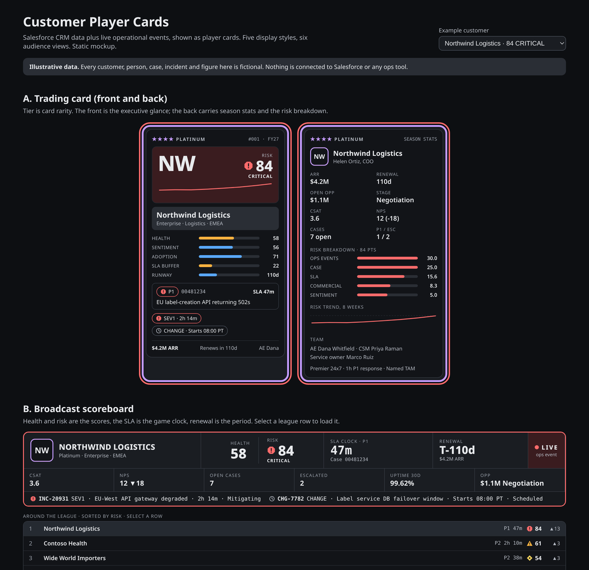
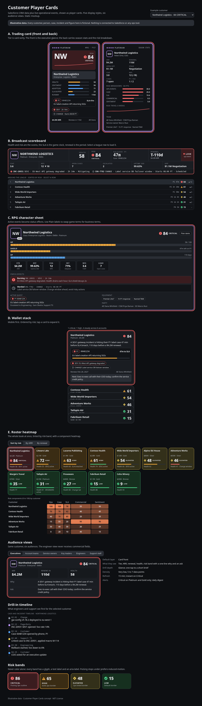

# Customer Player Cards

**Player-card style views of customer status: Salesforce CRM data plus live operational risk, tuned for each audience.**

[](https://github.com/jonzobrist/customer-player-cards/actions/workflows/ci.yml)
[](LICENSE)


Every customer gets a card. Like a sports trading card, the front answers five questions in two seconds, and the back and the drill-in carry the detail for the people who act on it:

1. **Who is this customer and how much do they matter?** Name, tier as card rarity, ARR, renewal runway.
2. **Are they healthy?** A long-term health score next to a live risk score with a band, a glyph and a trend.
3. **What is on fire right now?** Active incidents, degraded services and change windows as status chips.
4. **What is the one case to watch?** The current top case with its SLA countdown.
5. **Who owns the next move?** Owners, the ask, and the decision needed, tuned per audience.



> [!IMPORTANT]
> **All data in this repository is fictional.** Every customer, person, case number, incident, tenant id and figure (Northwind Logistics, Contoso Health, Wide World Importers and so on) is invented for illustration. Nothing here connects to Salesforce or any operational tool, and real customer data must never be committed.

## What is in this repo

This is a **concept and specification repository**, not an application. It contains:

| Path | What it is |
| --- | --- |
| [`mockups/index.html`](mockups/index.html) | A self-contained static mockup of all five styles and six audience views. Download it and open it in any browser; no build step, no network. |
| [`docs/`](docs/) | The concept, data model, risk score, audience views, visual rules and build plan. |
| [`prompts/`](prompts/) | Copy-paste build prompts for coding agents: one per style plus a shared backend prompt. |
| [`AGENTS.md`](AGENTS.md) | Rules for every contribution (human or agent): tests, operational instrumentation, documentation, security. |

## The five display styles

| Style | Idea | Best for | Form factor | Build effort |
| --- | --- | --- | --- | --- |
| **A. Trading card** | Portrait card; tier is rarity; front = glance, back = season stats | Executives, account teams, QBRs | Desktop grid, print | Medium |
| **B. Broadcast scoreboard** | Score bug: health and risk are the score, SLA is the game clock, incidents run in a ticker; league table | Key leaders, support floor | Wall display | Medium |
| **C. RPG character sheet** | HP, shield and XP bars; incidents are status effects; a Plain labels toggle | Engineers, support, service owners | Desktop panel | Medium-high |
| **D. Wallet stack** | Calm stacked cards ordered by risk; tap to expand | Executives on mobile | Phone, PWA | Low |
| **E. Roster heatmap** | Grid of mini cards tinted by band, a component heatmap, blast-radius mode | Key leaders, service owners | Wide desktop | Low-medium |

**Suggested pairing:** ship **E** as the home screen with **A** as the card it opens, and reuse **C**'s status effects for the engineer and support drill-in. Add **B** for wall displays and **D** for mobile once the data layer is live. Details: [docs/concept.md](docs/concept.md).

<details>
<summary>Full-page screenshot of every mockup</summary>



</details>

## Audience levels

The same card renders differently for six audiences. Field filtering happens on the server, never only in CSS.

| Audience | Default layer | What they see | Refresh |
| --- | --- | --- | --- |
| Executives | Card front | Tier, ARR, renewal, health, risk band, one-line why, the ask | 15 min; instant on Critical |
| Account teams | Front + back | Opportunity, renewal, CSAT/NPS trend, cases, top case, sponsor, next best action | 5 min |
| Service owners | Back + service drill | Incidents on their services, blast radius, SLA exposure, change windows | Real-time |
| Key leaders | Back + roster | Escalations, blast radius, decisions needed, owners, 8-week trend | 1 min |
| Engineers | Drill-in | Incident detail, tenants, linked cases, runbooks, recent changes; **no commercial fields** | Real-time |
| Support staff | Drill-in on case | SLA countdown, entitlement, last contact, known-incident banner, next action, timeline | Real-time |

More: [docs/audience-views.md](docs/audience-views.md).

## The risk score

```text
Risk = 0.30·Ops + 0.25·Case + 0.20·SLA + 0.15·Commercial + 0.10·Sentiment
```

Each component is scored 0 to 100. Overrides: an active SEV1 linked to an open P1 case floors the score at 80; any breached SLA floors it at 70; an executive escalation adds 10. Bands: **80-100 Critical, 60-79 High, 40-59 Elevated, 0-39 Low.** Every card stores its components and the overrides that fired, so every score can explain itself.

Never color alone: each band has a color, a glyph shape, a text label and an aria-label. More: [docs/risk-score.md](docs/risk-score.md) and [docs/visual-rules.md](docs/visual-rules.md).

## Roadmap

| Phase | Scope | Exit criteria |
| --- | --- | --- |
| 0 · Discovery | Prototype styles with the prompts; interview two people per audience; confirm fields and case-to-incident linking | Style chosen; field list and risk weights agreed |
| 1 · MVP | Read-only cards for the top 50 accounts; roster + trading card; exec, account and support views; Salesforce REST + PagerDuty webhooks; SSO | Used in a weekly account review; data matches Salesforce |
| 2 · Live ops | CDC streaming, ServiceNow, status page, monitoring; linker; all six views; SLA countdown; Slack/Teams alerts | A SEV1 shows on the card in under 60 s |
| 3 · Scale | All accounts; blast-radius mode; risk history; wall display and mobile; weight tuning | Risk band predicts escalations better than today's process |
| 4 · Act | Write-backs with approvals; predictive risk; generated "why" summaries with citations | Agreed per action |

Details, stack, integration steps, permissions and open questions: [docs/build-plan.md](docs/build-plan.md).

## Using the build prompts

1. Pick a style from the table above.
2. Open its prompt in [`prompts/`](prompts/) and paste the whole fenced block into your coding agent (Cursor, Claude Code, Codex, Grok or similar) in an empty repo or a new `apps/` folder.
3. Also give the agent [AGENTS.md](AGENTS.md) so its output meets this project's bar for tests, instrumentation and docs.
4. Check the result against the prompt's acceptance criteria.
5. When a style is chosen, build the data layer with [`prompts/backend.md`](prompts/backend.md) against a Salesforce sandbox and mocked ops sources.

## Viewing the mockups

- **Download and open:** save [`mockups/index.html`](mockups/index.html) and open it in a browser. It has the React bundle inlined, so it works offline.
- **Rebuild from source:** the mockup source is in [`mockups/src/`](mockups/src/). Run `npm ci && npm run build` inside `mockups/` to regenerate `index.html`.

## Contributing

Contributions are welcome: new display styles, sharper audience views, better risk rules, accessibility improvements, and (in later phases) code.

- Read **[AGENTS.md](AGENTS.md)** first. It applies to humans and AI agents alike and defines the definition of done: **tested, operationally instrumented, and documented**.
- See [CONTRIBUTING.md](CONTRIBUTING.md) for the workflow, [CODE_OF_CONDUCT.md](CODE_OF_CONDUCT.md) for community expectations, and [SECURITY.md](SECURITY.md) for reporting vulnerabilities.
- Design decisions go in [docs/adr/](docs/adr/); notable changes go in [CHANGELOG.md](CHANGELOG.md).

## License

[MIT](LICENSE) © 2026 Jon Zobrist

Salesforce, Service Cloud, PagerDuty, ServiceNow, Datadog and other product names are trademarks of their respective owners. This project is not affiliated with or endorsed by any of them.
