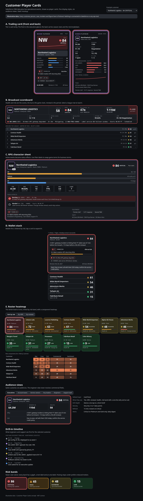

# Concept

> All customers, people, cases and incidents in this document are fictional.

## Problem

Customer status is scattered. Commercial context lives in Salesforce (account, opportunity, renewal, ARR, owners). Support context lives in Service Cloud (cases, entitlements, SLA milestones). Operational reality lives in incident, status-page, monitoring and change tools. When something breaks, an executive, an account manager, a service owner and a support engineer each open different tools and still miss the connection: *this SEV1 is hitting a Platinum customer's P1 case 47 minutes before SLA breach, 110 days before a $4.2M renewal.*

## Idea

Give every customer a **player card**: one consistent, highly visual summary that combines CRM and live ops data and computes an explainable **risk score**. Like a sports trading card:

- The **front** answers five questions in two seconds: who and how much they matter, are they healthy, what is on fire, which case to watch, who owns the next move.
- The **back** carries the season stats: commercial context, sentiment, case counts, the risk breakdown, owners and the trend.
- The **drill-in** is where work happens: the case timeline, linked incidents, tenants, runbooks and recent changes.

Each audience lands on a different layer with different fields (see [audience-views.md](audience-views.md)).

## Principles

1. **Glance first, detail on demand.** Progressive disclosure: front, back, drill-in.
2. **One score, always explainable.** The risk score stores its components and the overrides that fired. No black boxes.
3. **Never color alone.** Every state has a glyph, a label and an aria-label, and reads in grayscale.
4. **Right fields for the right people.** Filtering is server-side; engineers never receive commercial fields.
5. **Live, but calm.** Real-time where it matters, with motion that is optional and respectful of reduced-motion settings.
6. **Read-only first.** Write-backs to Salesforce only in a later phase, with approvals.

## The five styles

| Style | Metaphor | Strength | Weakness |
| --- | --- | --- | --- |
| A. Trading card | Sports card; tier is rarity | Memorable; front/back maps to glance vs detail; prints for QBRs | Portrait cards waste wide screens; 8-12 per screen |
| B. Broadcast scoreboard | TV score bug + league table | Built for wall displays; SLA as a game clock | Can feel gimmicky; needs a wide screen; ticker must pause |
| C. RPG character sheet | HP, shield, XP, status effects | Incidents as status effects fit naturally; dense but readable | Game terms need learning; highest design effort |
| D. Wallet stack | Stacked cards ordered by risk | Mobile first and calm; lowest build effort | Low density; poor for comparison |
| E. Roster heatmap | Team roster + heatmap | Whole book at once; blast radius; explains drivers | Tiles carry little detail; color-heavy |

### Suggested pairing

Ship **E** as the home screen with **A** as the card it opens, and reuse **C**'s status effects for the engineer and support drill-in. Add **B** for wall displays and **D** for mobile once the data layer is live.

## Mockups

Open [`mockups/index.html`](../mockups/index.html) in a browser. It renders all five styles from six fictional customers, with an example-customer picker and an audience switch.

## Related

- [data-model.md](data-model.md): where every card field comes from
- [risk-score.md](risk-score.md): how the score is computed
- [visual-rules.md](visual-rules.md): bands, glyphs, motion and accessibility
- [build-plan.md](build-plan.md): phases, stack, integration and open questions
